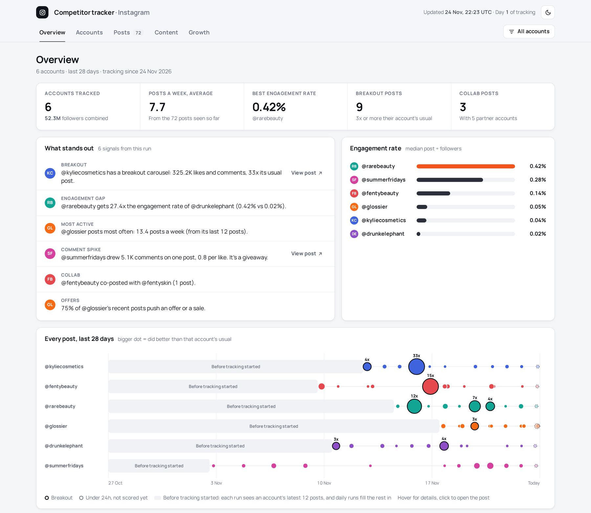
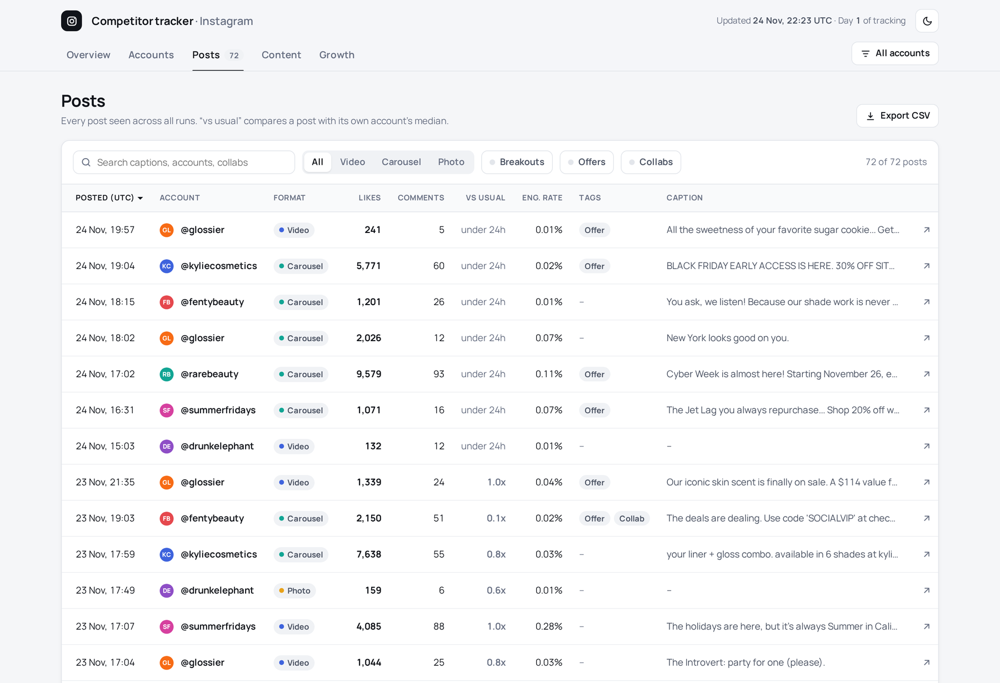
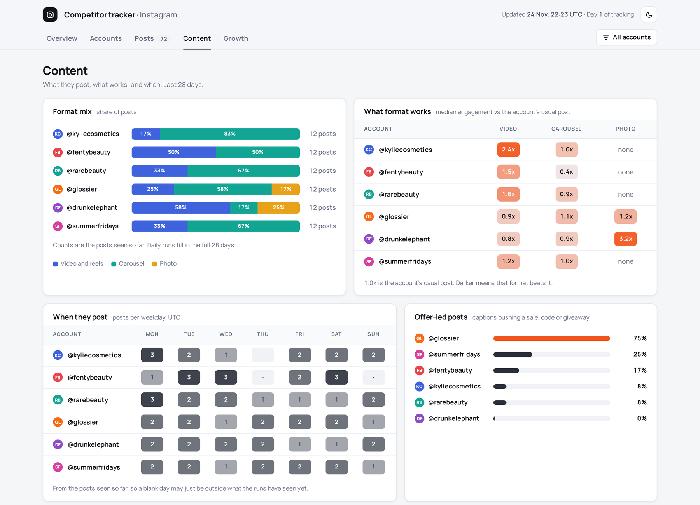
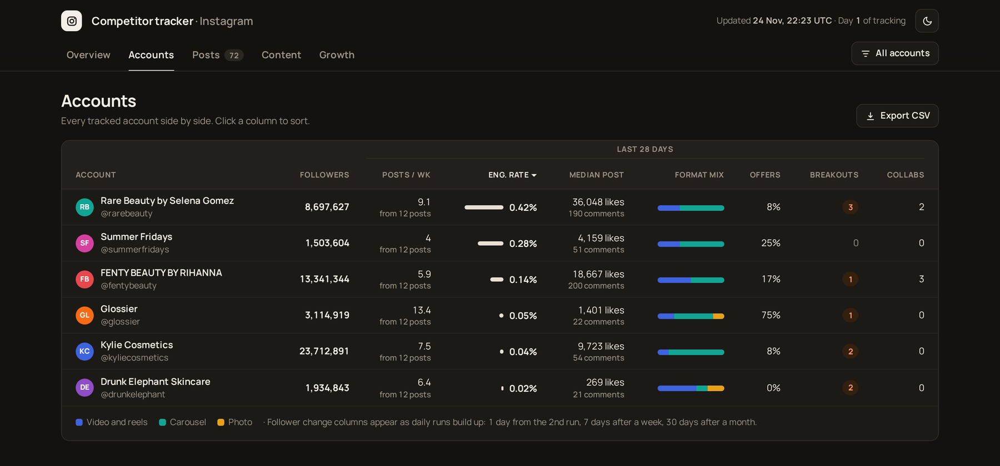

# Upscrape skills

Skills for your AI agent that go and get live data, then hand you back something you'd actually show a client or your team. Not a JSON dump, not a wall of text.

They use the open SKILL.md format, so they work in Claude Code, Codex, Cursor and any other agent that reads skills.

```bash
npx skills add upscrape/skills
```

---

## Instagram competitor tracker



You know the routine. Five competitor profiles open in tabs, scrolling their grids, screenshotting posts into a deck, and trying to guess whether 40K likes is good *for that account*. Then you do it again next week.

This skill does that part for you. Tell your agent which accounts to watch. It pulls their profiles and latest posts, works out what's normal for each one, and gives you a single HTML file with five tabs. Run it every day and it keeps the history, so the picture gets sharper the longer it runs.

### What it caught on day one

We pointed it at six beauty brands on 24 Nov 2026. One run, six accounts, 30 credits. A few things it flagged:

- **`@kyliecosmetics` had a carousel doing 33x its usual post.** 325.2K likes and comments, when that account's typical post gets 9.8K.
- **A typical `@rarebeauty` post gets 36.2K likes and comments. A typical `@kyliecosmetics` post gets 9.8K.** Kylie has 2.7x the followers.
- **`@glossier` posts 13.4 times a week, and 75% of those posts push an offer or a sale.**
- **`@summerfridays` got 5.1K comments on a single post.** That's 0.8 comments per like. It was a giveaway.

You won't spot any of that from scrolling a grid.

### What's inside

| Tab | What it answers |
| --- | --- |
| **Overview** | What stands out, in plain sentences. Engagement rate side by side. Every post of the last 28 days on one timeline, where a bigger dot means it beat that account's own usual. |
| **Accounts** | Followers, follower change, posts a week, engagement rate, a typical post, format mix, offer share, breakouts and collabs. Sortable. |
| **Posts** | Every post seen, searchable and filterable (video, carousel, photo, breakouts, offers, collabs), each one scored against its own account. Export to CSV. |
| **Content** | Which formats each account posts, which format actually works for them, which days they post, and who they collab with. |
| **Growth** | Follower change over time, once a few daily runs have built up. |





It's one HTML file with nothing to install. It opens offline, has light and dark modes, and you can email it, drop it in Slack or put it in a client folder.



### It won't make things up

We were strict about this one, because a dashboard that looks smart and lies is worse than no dashboard.

- **A breakout is judged against that account's own normal**, not against the biggest brand in the list. A small account's 3x post shows up just like Kylie's.
- **Posts under 24 hours old are shown but not scored.** They're still collecting likes, and calling them flops would be wrong.
- **No fake trend lines.** On day one the Growth tab says the trend starts tomorrow, instead of drawing a line from one dot.
- **Empty columns disappear** rather than showing a row of zeros.
- **Reel view counts and paid-partnership labels aren't in it yet**, and the dashboard says so at the bottom.
- **Avatars are initials, on purpose.** Instagram's image links expire after a while, and your report shouldn't break a week later.

### Use it

1. Install: `npx skills add upscrape/skills` (or copy `skills/instagram-competitor-tracker` into your agent's skills folder).
2. Get an Upscrape key and set `UPSCRAPE_API_KEY`, or connect the Upscrape MCP server at `https://data.upscrape.com/mcp`.
3. Ask your agent:

> Track `@glossier`, `@rarebeauty` and `@fentybeauty` on Instagram.

If one of the accounts is yours, say so and it gets marked "You", so everything is compared against you.

The agent tells you what a run costs before it makes a single call. It works with public accounts only, and needs no Instagram login.

### What it costs

Each account is **5 credits a run**, and failed calls are free.

- 6 accounts, once: 30 credits.
- 6 accounts, every day for a month: 900 credits.
- New accounts start with up to 100 free credits, so you can try it a few times before paying anything. The smallest pack is $19 for 10,000 credits ([pricing](https://upscrape.com/pricing)).

Run it twice on the same day and the second run reuses that day's data, so you don't pay twice.

### Agencies: run it daily and put your brand on it

> Run this every day, and brand it for my client Acme Beauty with our agency's logo.

The agent sets up a daily run on GitHub Actions, so the history keeps building while your laptop is closed (use a private repo for that). It also puts your agency's name, logo and colour on the report, so it's ready to send to a client.

---

## About Upscrape

[Upscrape](https://upscrape.com) is one API and one MCP server for live, structured data from the platforms companies actually care about: marketplaces, grocery, social, maps, jobs and any website. You see the price before every call, and failed calls are free.

These skills are what we build when we want to show what that data is good for. More are coming. If there's one you want, [open an issue](https://github.com/Upscrape/skills/issues).

## License

MIT. The dashboard embeds the Manrope font under the SIL Open Font License.
